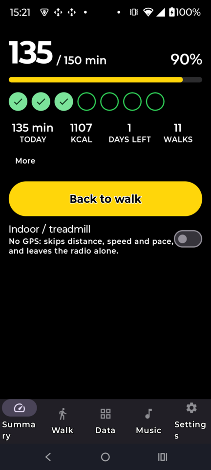
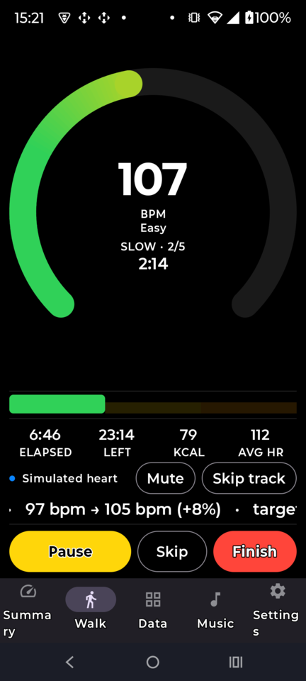
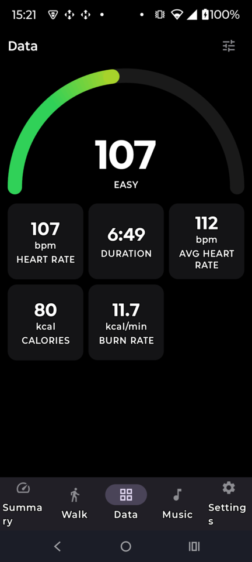
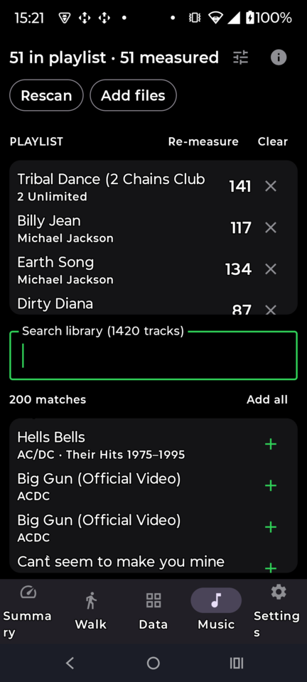
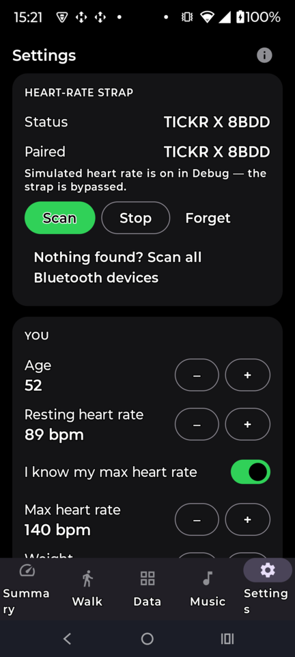

# Japanese Walk — Interval Walking Training for Android

A single-user, fully offline Android app for the Japanese Walking protocol
(Interval Walking Training, Nemoto et al.): **5 × 3 min brisk / 3 min easy = 30 min**,
driven by a Bluetooth heart-rate strap, with a voice coach, pace-matched music from
your own music folder, Apple-Watch-style 270° heart-rate zone rings, and a weekly
150-minute goal.

No account. No cloud. No analytics. Nothing leaves the phone.

** Build it yourself, see §2.
Android 13 (SDK 33) or newer. You will need to allow install from an unknown source once.

---

## Screenshots

| Summary | Walk | Data |
|---|---|---|
|  |  |  |
| Week against the 150-minute goal, one circle per session, Start button with the indoor/treadmill switch under it. | The live 270° zone gauge mid-session: interval, time left, heart rate, and the current track. No scrolling. | The 180° arc plus whichever nine metrics you pick — pace, distance, calories, average and max HR. |

| Music | Settings |
|---|---|
|  |  |
| Search the scanned catalogue, add tracks to the workout queue, see each one's measured tempo. | Strap pairing and status, then your profile — age, resting and max heart rate, weight. Protocol, voice coach and zone colours follow below; explanatory text is tucked behind (i). |

<sub>Capture or refresh these with `./tools/capture-screenshots.sh` while a device is attached.</sub>

---

## 1. What it does

| Area | Behaviour |
|---|---|
| **Protocol** | 5 sets × (3 min fast + 3 min slow), starting with the slow bout as per the published protocol. Sets, bout lengths, intensities, tolerance, warm-up and cool-down are all adjustable. |
| **Intensity** | Karvonen — a share of **heart-rate reserve**: `HR = rest + pct × (max − rest)`. The figure you set is the **top of a range**, not a point to hit: with the default 20-point band, a 70% fast target means "anywhere from 50% to 70%" (roughly a 25 bpm window). The slow bout has a ceiling only — drifting lower is the goal and is never coached against. |
| **Heart rate** | Any standard BLE strap (Polar, Garmin, Wahoo, Coospo, Magene…) via GATT Heart Rate Service `0x180D` / characteristic `0x2A37`, plus battery level `0x2A19`. Auto-reconnects with backoff. A **simulator** lets you try everything indoors with no hardware. |
| **Gauge** | One thick 270° arc, filled proportionally to your heart rate: the part you have reached is painted in a gradient running green → yellow → orange through the zone bands, the part above it stays grey. It moves from well below resting heart rate upward, so it is never parked at the origin. The Data tab shows the same gradient as a 180° arc. Below it, one box per set — each split into its slow and fast bouts in proportion, painted light green and light orange as you work through them, the rest left dim so the shape of the whole session is visible from the first second. |
| **Two modes** | **Walking** outdoors or on a treadmill, or **indoor cycling** on a smart trainer. Same protocol either way — five sets of three minutes hard and three easy, judged by heart rate — only the lever differs: your pace on foot, the trainer's resistance on a bike. |
| **Zone model** | Two mutually exclusive scales, chosen in Settings. **% of heart-rate reserve** (Karvonen) is what the published protocol is written in. **% of max heart rate** with 220 − age is what a Galaxy Watch or Garmin shows — pick it and the zone boundaries *and* the interval targets both switch, so colours and coaching can never end up in different scales. |
| **Zones** | Three zones by %HRR — **Z1 Easy** (green, up to 45%), **Z2 Brisk** (yellow, 45–58%), **Z3 Hard** (orange, above 58%). Mapped to the protocol rather than to a generic five-zone chart: the 40% slow bout sits in green, the 70% fast bout in orange, so the colour alone tells you whether you are on protocol. Bounds and colours live in one enum. |
| **Expected heart rate** | A heart does not step. Asked to go from easy to brisk it takes a minute to arrive and as long to come back down, so the target range **ramps** across each bout change instead of jumping — a saw-tooth, not a square wave. The coach and the gauge both read the ramped band, which is what stops "well under target" firing at second three of a fast bout. Adjustable, 0 restores hard steps. |
| **After the last bout** | The strap stays connected. Minutes and calories keep accruing as easy walking until your heart rate has settled back into zone 1 (or ten minutes pass), because people do not stop dead when the timer does. |
| **Interruptions** | An incoming call pauses the walk, mutes the music and silences the coach — voice cues use navigation-guidance audio, which the system will happily mix straight into a call. It picks up again when you hang up, and does not un-mute music you had muted yourself. |
| **Voice coach** | Spoken interval changes, countdowns, halfway call-out, off-range correction, strap-loss warnings, end-of-session summary. Deliberately reluctant: interval changes and countdowns are always on time, everything else waits for a quiet window (40 s by default), must have drifted for 35 s, and stays silent for the first 45 s of a bout while the heart catches up. All three are adjustable. Ducks the music while it speaks. |
| **Trainer control** | Over BLE FTMS (0x1826): reads power, cadence and speed from Indoor Bike Data, and **writes** the target back, so each bout sets its own resistance instead of asking you to shift. ERG (target watts) or resistance level. Because the bouts are prescribed in heart rate and how many watts that takes differs by person and by day, the target then *seeks*: small steps, well spaced, and the correction carries over to the next bout of the same kind rather than being re-learnt every three minutes. Calories come from measured work rather than the heart-rate model. |
| **Music** | You build the playlist by hand. Scanning a folder you grant (typically the SD card or its `Music` folder) catalogues everything five levels down with its ID3 tags; you then **search by title, artist, album or file name** and add the tracks you want, or pick individual files straight from the system picker. Copies of the same song in more than one place are collapsed to one. Each queued track's tempo **and loudness** are measured on-device once and cached — loudness by EBU R 128 / ITU-R BS.1770 (K-weighting, 400 ms blocks, both gates), so a change of track in headphones does not startle you. Levelling works from the playlist's **median** loudness: the loud outliers come down, the quiet ones are lifted by an audio-effect gain, and the typical track is not touched at all. That last part matters — an earlier version levelled to the *quietest* track, which matched them perfectly and made the app half as loud as every other player on the phone. Both limits are adjustable, 8 dB down and 6 dB up by default. During a bout the app picks the track closest to the target cadence and pitch-corrected time-stretches it (±8% by default) onto the beat. Or hand the job to another music app entirely — voice cues still duck it. Mute, unmute and skip tracks mid-walk. |
| **Notification** | Pause, finish, mute the music and skip a track from the shade without unlocking. A media session is published too, so lock-screen and headset transport buttons act on the playlist. |
| **Screens** | Five tabs, swipeable. **Summary** is the launch screen, kept sparse: the week's minutes against the goal, one circle per session — filled green with a tick once walked — and the Start button, with monthly figures behind *More*. **Walk/Ride** is a single fixed page — gauge, set boxes and controls, no scrolling — and its tab icon follows the armed mode, walker or bicycle. **Data** carries the 180° arc and a grid of metric tiles you choose yourself. **Music** and **Settings** keep all their explanatory text behind an (i) button. Finishing a walk returns to Summary with refreshed totals. |
| **Indoor / treadmill** | A switch under the Start button. GPS is never requested, the location permission is not needed, and the distance, pace and speed tiles read `--` instead of drifting. Everything else — intervals, zones, coach, music, calories — is unchanged. |
| **Indoor cycling** | The same protocol on a smart trainer: five sets of three minutes hard and three easy, still judged by heart rate, with low/high resistance in place of slow/fast walking. Talks Bluetooth FTMS (0x1826) to read power and cadence and to **set the target itself** each bout — ERG watts or resistance level — so there is nothing to shift. Because the bouts are prescribed in heart rate and how many watts that takes differs by person and by day, the target creeps up or down between bouts until the heart rate sits in the band. Calories come from measured work rather than the heart-rate model. Tested against a Wahoo Kickr Core v2. |
| **Stats** | Local Room database: duration, calories, avg/max HR, per-zone seconds, on-target %, completed sets, plus a per-session HR trace. |
| **Weekly goal** | 150 min/week starting **Monday**: minutes, calories, % of target, days left, and one circle per planned session. A daily reminder states where the week stands and what would finish it — plainly, with no scores or streaks. |

### Calories

Heart-rate based, using Keytel et al. (2005) — the right model here because a strap
is already streaming HR. When the strap drops out the estimate falls back to a
walking MET value so the session total keeps advancing instead of stalling.

---

## 2. Building & Installing via adb

```bash
# from the project root
./gradlew test                   # 60 unit tests, no device needed
./gradlew assembleDebug          # app/build/outputs/apk/debug/app-debug.apk    (~65 MB)
./gradlew assembleRelease        # app/build/outputs/apk/release/app-release.apk (~3.5 MB)
```
or 

```
./gradlew test assembleRelease && adb install -r app/build/outputs/apk/release/app-release.apk
```

### The release build

`assembleRelease` is the one to install for real use: R8 shrinks and obfuscates,
unused resources are stripped, `Log.v/d/i/w` calls are removed (`Log.e` is kept so
crash reports stay readable), the app is not debuggable, and the dependency
metadata block is left out of the APK.

Signing comes from `keystore.properties` at the project root, gitignored along with
`*.jks`. If that file is missing the release APK is left **unsigned** rather than
quietly falling back to the debug key, and Gradle warns you. To create a key from
scratch:

```bash
keytool -genkeypair -v -keystore release.jks -alias japanese-walk \
        -keyalg RSA -keysize 4096 -validity 10000
cat > keystore.properties <<'EOF'
storeFile=release.jks
storePassword=<what you just typed>
keyAlias=japanese-walk
keyPassword=<what you just typed>
EOF
```

Keep **both** files. An update can only install over an existing copy of the app if
it carries the same signature, and a lost key cannot be recovered.

> **Switching from a debug build wipes local data.** Debug and release are signed
> with different keys, so Android refuses to install one over the other: you have to
> `adb uninstall com.telecomprofi.japanesewalk` first, and that takes the workout history
> and settings with it. Worth doing early, while there is little to lose. After that,
> release installs upgrade in place and keep everything.

Requirements: **JDK 17+**, Android SDK **Platform 35** and Build-Tools 35, or just open
the folder in Android Studio (Ladybug or newer) and press Run.

Configuration: AGP 8.7.3 · Gradle 8.11.1 · Kotlin 2.0.21 · Compose BOM 2024.12.01 ·
Room 2.6.1 (KSP) · Media3 1.5.1 · WorkManager 2.10.0 · **minSdk 33, targetSdk 35**.

> **Note on the build:** this project was written and its logic verified in a sandbox
> without network access to Google's Maven or Maven Central, so the Gradle build could
> not be executed there. Everything that does not require the Android SDK — the zone and
> Karvonen maths, the calorie model, the interval timeline, the accumulator, the playlist
> parsers, the tempo estimator and the track matcher — **was compiled with kotlinc 2.1.21
> and all 60 unit tests were run and pass**. The Android/Compose layer was reviewed but
> not compiled. Expect the first `assembleDebug` on your machine to be the real proof;
> anything it flags will be small and local.

---

## 3. First run

1. **Settings → You** — set age, resting HR, weight and sex. Everything downstream
   (zones, targets, calories) derives from these, so it is worth two minutes.
   Check the *Your zones* card: it prints your actual BPM ranges and the two targets.
2. **Settings → Heart-rate strap** — put the strap on (dry contacts read badly), tap
   **Scan**, tap **Use**. If nothing appears, use *Scan all Bluetooth devices* — a few
   straps do not advertise `0x180D` until connected. No strap to hand? Flip on
   **Simulate heart rate**.
3. **Music → Scan folder** — grant the folder that holds your music. On an SD card
   that is usually the card root or its `Music` folder. The scan walks five levels
   down, reads each file's ID3 tags, and skips `Android/` (that is where per-app
   private copies live, and the reason the same song used to appear two or three
   times). Progress is reported phase by phase and can be cancelled.

   Then **search** the catalogue and tap **+** on the tracks you want, or **Add all**
   for everything matching the current search. **Add files** picks individual files
   from the system picker instead, including from outside the scanned folder.

   Tempo is measured once per queued track — roughly 1–3 s each, in the background,
   cached thereafter.

   Prefer your own player? Turn on *Use my other music app instead* and the built-in
   player is never created; voice cues duck whatever is playing via audio focus.

4. **Start Workout** from the Summary screen. Grant notifications and Bluetooth when asked.

You can lock the screen and put the phone in your pocket; the session runs in a
foreground service with a wake lock, and the notification carries Pause / Resume /
Finish.

### Why a folder picker instead of a path

Android 13+ has no legal way to read `/sdcard/Music/workout.m3u` by path — a playlist
file is not indexed media, and the all-files permission is not grantable for an app like
this. The Storage Access Framework grant you give once covers the playlist *and* the
audio files, works on removable SD cards, and survives reboots.

---

## 4. How the pace matching works

1. Each interval has a target cadence in steps/min (defaults: 130 fast, 105 slow).
2. Half-time and double-time feels are musically equivalent, so a 65 BPM track is a
   legitimate match for a 130 spm cadence. The matcher considers ×0.5, ×1 and ×2, prefers straight time,
   and penalises anything played in the last eight tracks.
3. The winner is time-stretched onto the target with ExoPlayer's pitch-corrected
   pipeline, clamped to ±8% so nothing sounds like a chipmunk. The walk screen shows
   the track's real tempo, what it is playing at, and the stretch applied.

Tempo estimation is a from-scratch DSP chain, not a library: Hann-windowed STFT →
log-magnitude spectral flux onset envelope → local-mean subtraction → autocorrelation
with harmonic summing and a mild log-normal tempo prior → parabolic peak refinement →
octave folding. It is tested against synthetic drum loops from 92 to 150 BPM and lands
within 2 BPM, including the hi-hat cases that usually trick detectors into double time.

---

## 5. Project layout

```
app/src/main/java/com/telecomprofi/japanesewalk/
├── core/          pure Kotlin, no Android: zones, Karvonen, calories,
│                  interval timeline, session accumulator, week maths
├── data/
│   ├── db/        Room entities, DAOs, database
│   ├── prefs/     DataStore settings
│   └── repo/      stats (read) and workout (write) repositories
├── hrm/           BLE heart-rate client + simulator behind one interface
├── music/         folder catalogue, de-duplication, MediaCodec decode,
│                  tempo estimator, FFT, track matcher, ExoPlayer wrapper
├── workout/       interval engine, voice coach, foreground service, hub
├── game/          notifications and the WorkManager weekly reminder
└── ui/            Compose theme, the 270° rings, four screens, view models
```

The rule the tree follows: **anything that is a calculation lives in `core/` or in a
pure file, with no Android imports**, which is why it can be unit-tested on the JVM.
Android objects appear only where they are unavoidable.

`app/src/test/` holds the tests: zone/Karvonen/calorie maths, the interval timeline
and accumulator, tempo estimation against synthetic click tracks, duplicate collapsing,
the track matcher, session circles, reminder wording, Monday/month-based date maths, loudness measurement against synthetic tones, and every FTMS
frame layout.

---

## 6. Tuning it

Everything below is one edit away:

- **Zone bounds and colours** — `core/HrZone.kt`. Each zone carries bounds for *both*
  intensity models; `UserProfile.hrForIntensity` / `intensityForHr` are the only conversions
  the rest of the app uses, so a percentage can never be read in the wrong scale.
- **How fast the expected heart rate ramps** — `IwtProtocol.transitionSec`, or Settings →
  During a walk.
- **Cool-down tracking** — `CoolDownSettings`: how long to keep counting, which zone counts
  as settled, and for how long.
- **Protocol defaults** — `core/IntervalPlan.kt` (`IwtProtocol`), or just use the Settings screen.
- **Coaching copy** — `workout/VoiceCoach.kt`, all spoken text in the `CoachScript` object.
- **Duplicate detection** — `music/TrackDeduper.kt`: identity is file name plus
  duration to the second, and `SKIPPED_DIRECTORIES` decides what never gets scanned.
- **How wide the target range is** — `IwtProtocol.bandWidthPct`, or Settings → Protocol
  → *Range width below the top*.
- **How talkative the coach is** — Settings → Voice coach has the quiet window, the
  drift grace period and the per-bout settle time.
- **Reminder wording** — `game/ReminderCopy.kt`.
- **Session circles** — `core/SessionDots.kt` (`MAX` caps how many fit a row).
- **Tempo analyser** — `music/TempoEstimator.kt` (frame/hop size, BPM range, fold range).
- **Loudness levelling** — `core/Loudness.kt` for the measurement, `LoudnessNormaliser` for the
  gain rule; target and on/off live on the Music tab.
- **Trainer protocol** — `trainer/FtmsProtocol.kt` is pure byte-twiddling with unit tests, so the
  frame layouts can be checked without a bike in the room; `trainer/TrainerControl.kt` is the GATT
  client. Easy/hard watts, the seeking step and its limits are in Settings → Indoor trainer.

---

## 7. Known limitations

- The foreground service declares the `mediaPlayback` type. If you turn music off, the
  service still runs under that type with nothing playing. It works and it is permitted,
  but if you would rather it be exact, add `health` as a second type plus
  `FOREGROUND_SERVICE_HEALTH` + `ACTIVITY_RECOGNITION` and choose the type at runtime.
- Tempo analysis reads 45 s from 25% into each track. Tracks with a tempo change
  mid-song get one number for the whole thing.
- Pace matching is unavailable when *Use my other music app instead* is on — the app
  has no control over another player's tempo, only over its own volume via audio focus.
- Track switching at interval boundaries is a 0.5 s volume fade, not a true crossfade —
  ExoPlayer needs two player instances for that.
- Cadence is a *target*, not a measurement; the app does not read the step counter. If
  you want closed-loop cadence, `ACTIVITY_RECOGNITION` plus `TYPE_STEP_DETECTOR` would
  slot into `WorkoutEngine` cleanly.
- Sessions are recorded but there is no screen listing them — only the weekly and
  monthly totals derived from them. The rows are all there if you ever want a history
  view back.
- One user, one device, no export. If you ever want your history off the phone, the
  Room database is at `/data/data/com.telecomprofi.japanesewalk/databases/japanese_walk.db`.

---

## 8. Licence

[MIT](LICENSE) — free for anyone to use, copy, modify and redistribute, including
commercially, provided the copyright notice and licence text travel with it. No
warranty of any kind.

Not a medical device. The heart-rate zones, targets and calorie figures are estimates
from published formulae (Karvonen, Tanaka, Keytel et al. 2005), not clinical
measurements. Talk to a doctor before starting interval training if you have any
cardiovascular condition.
